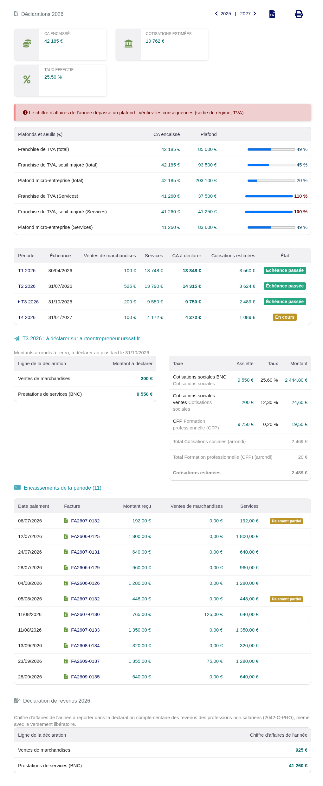
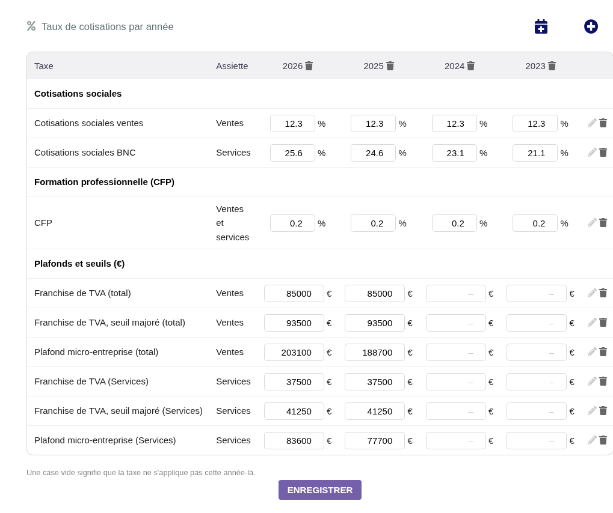
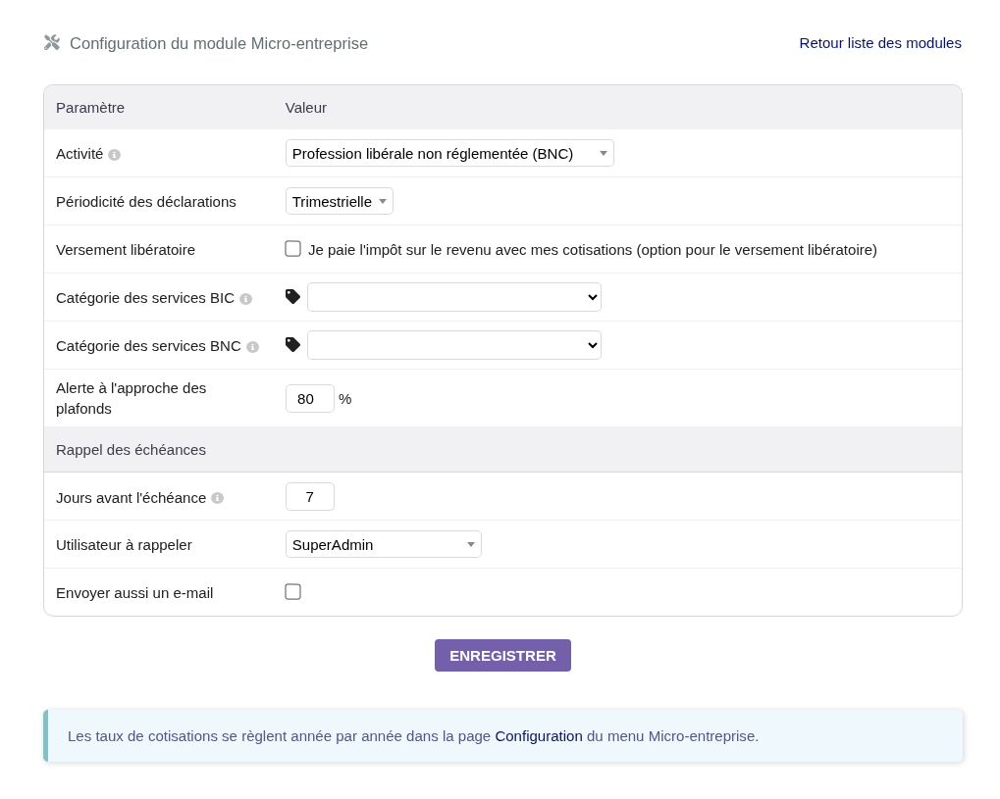
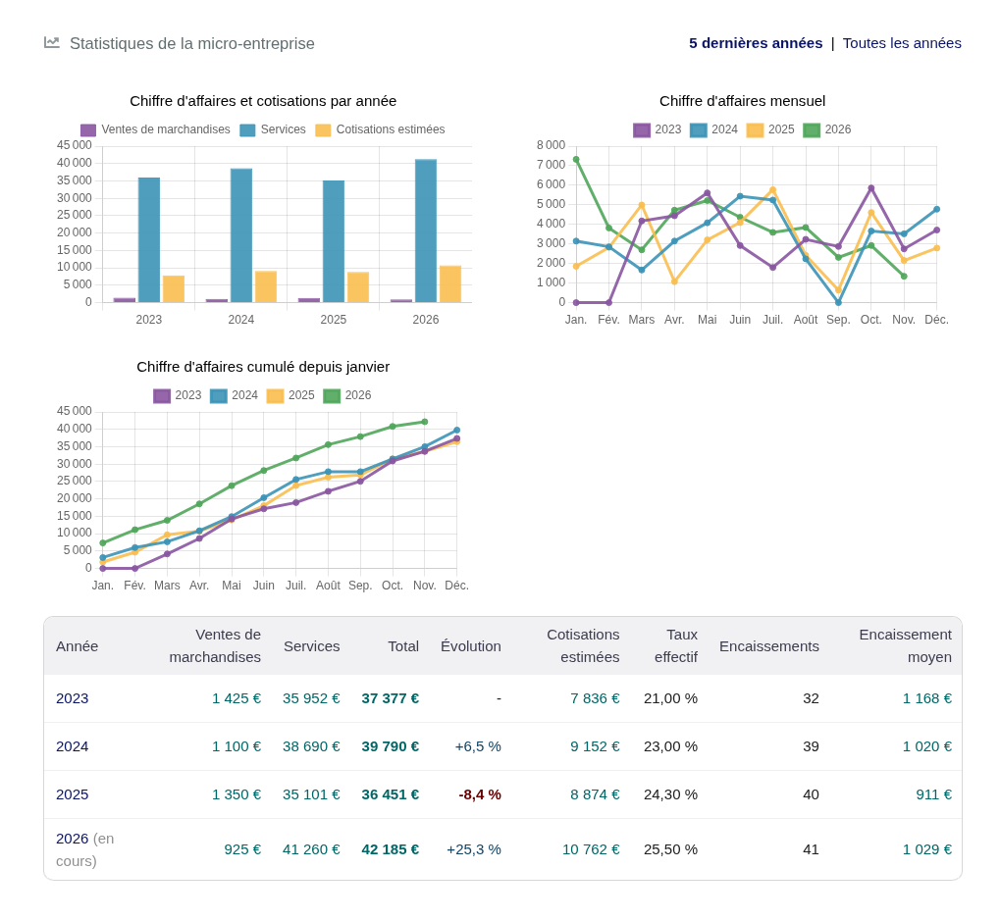
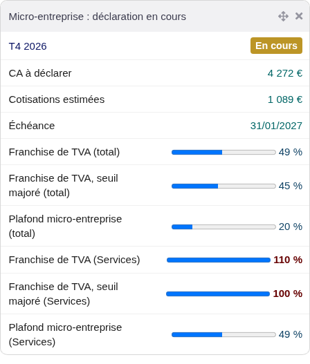

# Dolibarr Micro-entreprise Compta

A [Dolibarr ERP CRM](https://www.dolibarr.org) module for French micro-entreprises
(auto-entrepreneurs): the turnover to declare to the URSSAF for each month or
quarter, the estimated contributions, the ceilings, and how the activity changes
over the years. Everything comes from the customer payments already recorded in
Dolibarr.



## Features

The module adds a **Micro-entreprise** section to the accountancy menu.

### Declarations

One year at a time, one row per quarter or month with its URSSAF deadline and its
status (upcoming, in progress, to declare, deadline passed). For the selected
period:

- the amounts to type on autoentrepreneur.urssaf.fr, rounded to the euro, one line
  per activity (sales of goods, BIC services, BNC services);
- the detail of the estimated contributions: each rate, its base and its amount,
  rounded per category;
- the payments received, with a link to each invoice, and the partial payments.

The page also gives the yearly turnover for the income tax return (2042-C-PRO),
compares the turnover with the micro-entreprise ceilings and the VAT franchise
thresholds, and exports the periods as CSV.

### Setup



Rates are set in a table: one column per year, one row per tax, every value
editable at once. An empty cell means the tax does not apply that year. A new year
starts from the previous one, from the official URSSAF catalog (2025 and 2026), or
empty. On first use, choose your activity and start from the official rates.

The module setup (Home > Setup > Modules) sets the activity, the declaration
frequency (quarterly or monthly), the income tax in full discharge (versement
libératoire), the alert threshold for the ceilings, the deadline reminders, and the
product categories of BIC and BNC services for those who have both.



### Statistics



Yearly turnover and contributions, monthly turnover and turnover cumulated since
January (one line per year), and a table with the change from the previous year
(the running year is compared with the same months), the effective contribution
rate and the average payment.

### Home widget and reminders



A home page widget shows the period to declare. A daily scheduled job (Agenda and
Scheduled jobs modules) creates an agenda event some days before each deadline,
and can also send an email.

## How the turnover is computed

- **Cash basis**: each payment counts in the month it is received.
- **Excluding VAT**: under the VAT franchise this changes nothing; otherwise each
  payment is converted with the ratio of its invoice.
- **Activities**: goods are sales, services are BIC or BNC services depending on
  the activity of the setup, or on their product category.
- **Partial payments** settle the goods first, then the services. An amount paid
  above the invoice counts as services. A refund unwinds services first.
- **Deposits** count as the activity of the setup. A deposit or a credit note
  deducted from an invoice lowers each of its activities in proportion.
- **Contributions** apply each rate to the declared turnover of its base, then
  round the total of each category to the euro (rounded down before 2016 for the
  social contributions, the chamber fees and the other contributions).

The contributions are estimates. The catalog rates are those published by the
URSSAF and service-public.gouv.fr when they were added: check that they match your
situation.

## Install

Requires Dolibarr 23 or later, with PHP 7.2 to 8.5 like Dolibarr, and the
Invoices and Accounting (simplified) modules.

- **From the release zip**: download `module_automicroent-<version>.zip` from the
  [releases](https://github.com/Aohzan/dolibarr-micro-entreprise-compta/releases)
  and upload it in Home > Setup > Modules > Deploy external module.
- **From git**: clone the repository in a directory named `automicroent`:

  ```sh
  git clone https://github.com/Aohzan/dolibarr-micro-entreprise-compta.git htdocs/custom/automicroent
  ```

Then enable the module in Home > Setup > Modules, and give the *Configure the
micro-entreprise contribution rates* right to the users who set the rates.

### Upgrade

After each update, **disable then enable the module**: it migrates the data.
The rates and settings are kept.

## About this fork

This repository is a maintained fork of AutoMicroEntreprise, written by Fabrice
Delliaux and later kept by Sébastien Serre
([framagit.org/sebastienserre/automicroent](https://framagit.org/sebastienserre/automicroent)),
both now unmaintained. Its full history is kept here.

Only the repository has a new name: the module itself is still `automicroent`
(directory, rights class, `llx_ame_rates` table, translations), so an existing
installation upgrades in place and keeps its rates.

Bugs and pull requests are welcome in the
[issues](https://github.com/Aohzan/dolibarr-micro-entreprise-compta/issues).
Changes are listed in [ChangeLog.md](ChangeLog.md).

## Development

Tools are managed by [mise](https://mise.jdx.dev): `mise install`, then
`mise run install` (Composer and npm dependencies, git hooks). With Podman, copy
`mise.local.toml.example` to `mise.local.toml`.

| Command | What it does |
| --- | --- |
| `mise run lint` | All linters (prek: PHPCS, PHPStan, codespell, yamllint, markdownlint, zizmor) |
| `mise run test` | PHPUnit |
| `mise run dev` | Seeded Dolibarr on <http://localhost:8080> (admin / admin); `DOLIBARR=previous` for the previous major |
| `mise run e2e` | Playwright end-to-end tests against `mise run dev` |
| `mise run screenshots` | Regenerate the screenshots of this README |
| `mise run down` | Stop Dolibarr and drop its data |

Commits follow [Conventional Commits](https://www.conventionalcommits.org): merging
to `master` releases a new version with semantic-release. See
[AGENTS.md](AGENTS.md) for the code layout and conventions.

## License

GNU General Public License version 3, see [docs/COPYING](docs/COPYING).
